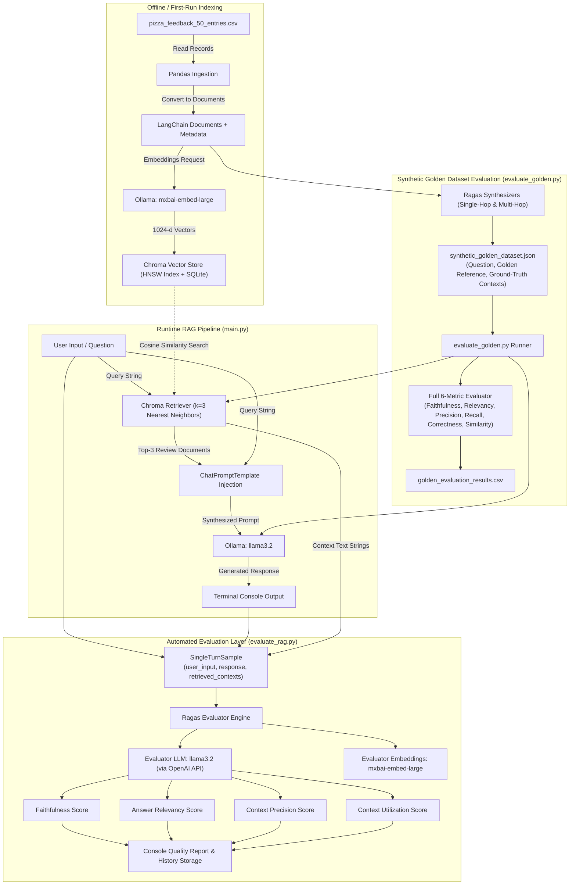
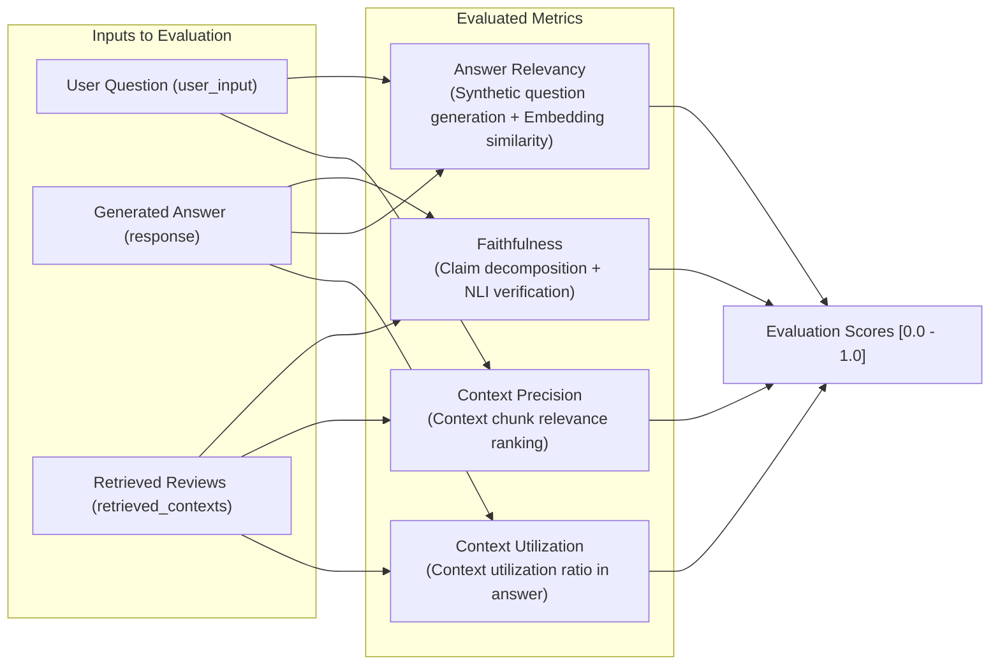
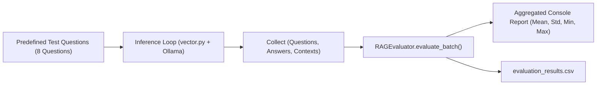
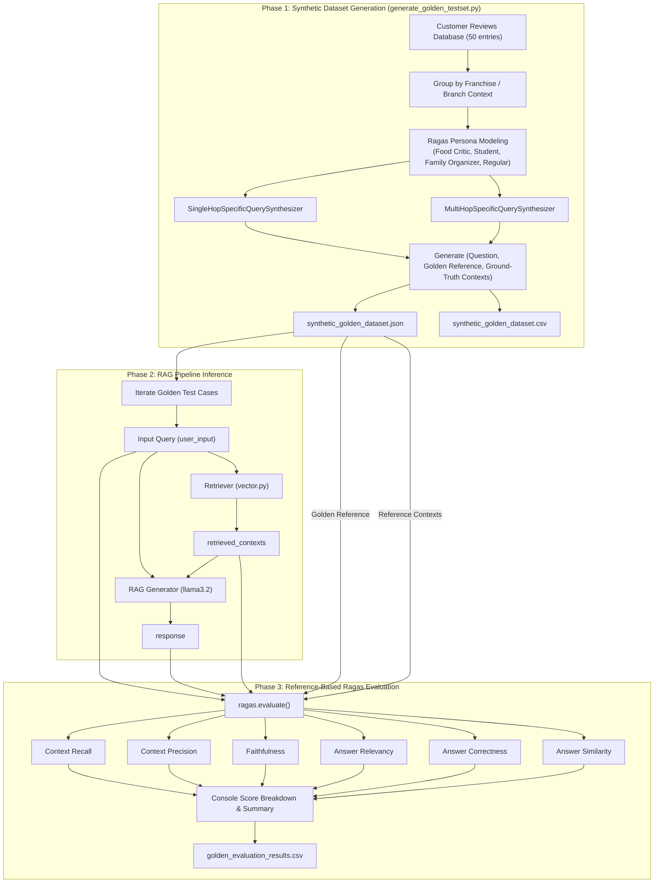
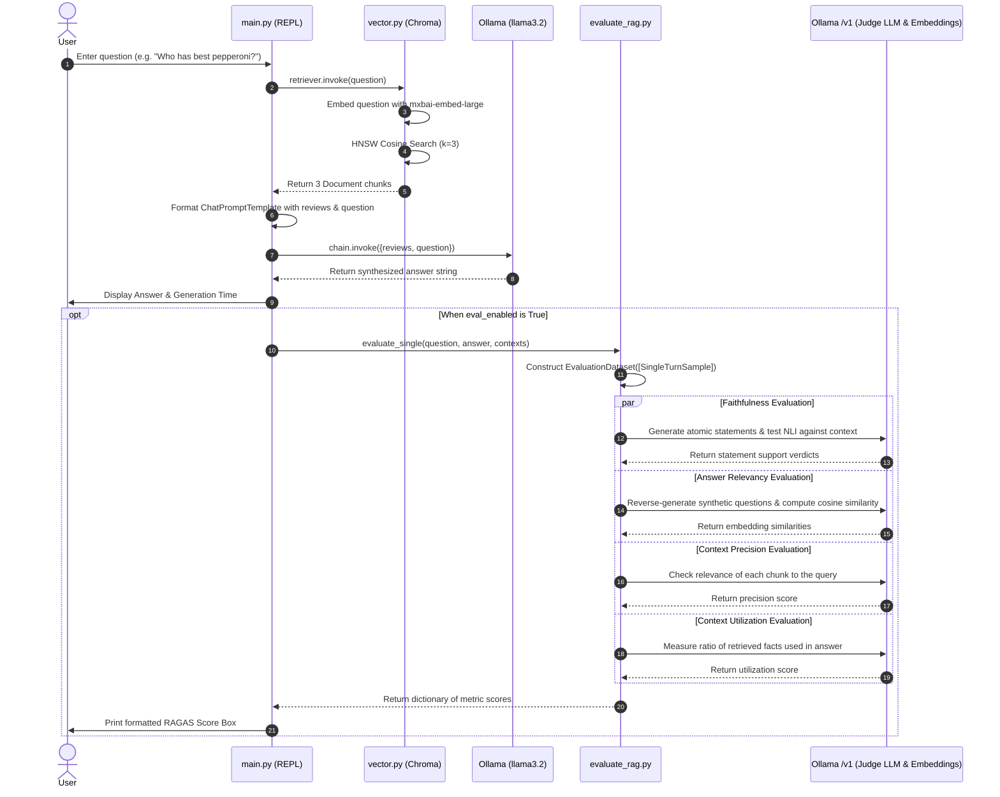
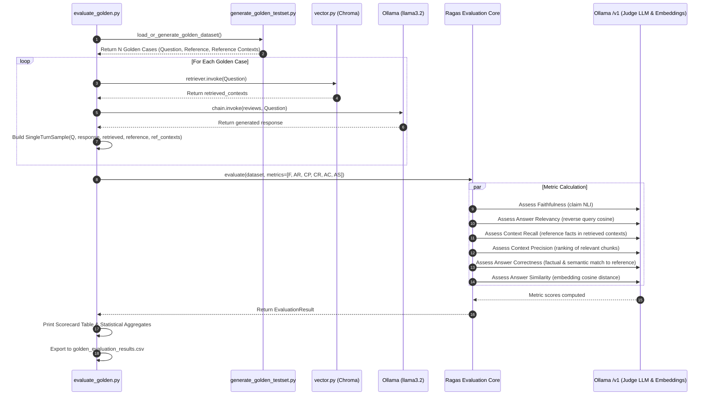

# Technical Wiki: Pizza Feedback RAG Application & Evaluation Subsystem

Welcome to the technical wiki for the **Pizza Feedback Retrieval-Augmented Generation (RAG)** application. This document provides an exhaustive, under-the-hood explanation of the application's architecture, data flows, embedding representations, retrieval mechanics, prompt synthesis, and the automated output evaluation layer implemented via the **Ragas** framework—including reference-free metrics and **synthetic golden dataset evaluation**.

---

## Table of Contents
1. [System Architecture Overview](#1-system-architecture-overview)
2. [Data Ingestion & Vector Indexing (`vector.py`)](#2-data-ingestion--vector-indexing-vectorpy)
   - [2.1 Source Data & Metadata Schema](#21-source-data--metadata-schema)
   - [2.2 Dense Vector Embeddings (`mxbai-embed-large`)](#22-dense-vector-embeddings-mxbai-embed-large)
   - [2.3 Chroma Vector Store & HNSW Indexing](#23-chroma-vector-store--hnsw-indexing)
   - [2.4 Similarity Search & Nearest Neighbor Retrieval](#24-similarity-search--nearest-neighbor-retrieval)
3. [The RAG Inference Pipeline (`main.py`)](#3-the-rag-inference-pipeline-mainpy)
   - [3.1 LangChain Expression Language (LCEL) Execution](#31-langchain-expression-language-lcel-execution)
   - [3.2 Context Augmentation & Prompt Engineering](#32-context-augmentation--prompt-engineering)
   - [3.3 Generation Mechanics (`llama3.2`)](#33-generation-mechanics-llama32)
   - [3.4 Interactive REPL & Session Control](#34-interactive-repl--session-control)
4. [The Output Evaluation Layer (`evaluate_rag.py`)](#4-the-output-evaluation-layer-evaluateragpy)
   - [4.1 Why Evaluate RAG Pipelines?](#41-why-evaluate-rag-pipelines)
   - [4.2 Ollama API Bridge for Ragas](#42-ollama-api-bridge-for-ragas)
   - [4.3 Metric 1: Faithfulness (Groundedness)](#43-metric-1-faithfulness-groundedness)
   - [4.4 Metric 2: Answer Relevancy](#44-metric-2-answer-relevancy)
   - [4.5 Metric 3: Context Precision (Without Reference)](#45-metric-3-context-precision-without-reference)
   - [4.6 Metric 4: Context Utilization](#46-metric-4-context-utilization)
   - [4.7 Async Execution, History Tracking & Statistics](#47-async-execution-history-tracking--statistics)
5. [Batch Benchmarking Subsystem (`evaluate_batch.py`)](#5-batch-benchmarking-subsystem-evaluatebatchpy)
6. [Synthetic Golden Dataset Generation & Automated Evaluation (`generate_golden_testset.py` & `evaluate_golden.py`)](#6-synthetic-golden-dataset-generation--automated-evaluation-generategoldentestsetpy--evaluategoldenpy)
   - [6.1 Theory of Synthetic Golden Test Data Generation](#61-theory-of-synthetic-golden-test-data-generation)
   - [6.2 Personas, Query Conditions & Synthesizers](#62-personas-query-conditions--synthesizers)
   - [6.3 Reference-Based Metric: Context Recall](#63-reference-based-metric-context-recall)
   - [6.4 Reference-Based Metric: Context Precision (With Reference)](#64-reference-based-metric-context-precision-with-reference)
   - [6.5 Reference-Based Metric: Answer Correctness & Factual Correctness](#65-reference-based-metric-answer-correctness--factual-correctness)
   - [6.6 Reference-Based Metric: Answer Similarity](#66-reference-based-metric-answer-similarity)
   - [6.7 Under the Hood: The `OllamaRagasEmbeddings` Dual-Protocol Adapter](#67-under-the-hood-the-ollamaragasembeddings-dual-protocol-adapter)
   - [6.8 Golden Dataset Evaluation Workflow](#68-golden-dataset-evaluation-workflow)
7. [End-to-End Sequence Diagrams](#7-end-to-end-sequence-diagrams)
8. [Repository File Inventory](#8-repository-file-inventory)
9. [Operational Runbook & Quickstart](#9-operational-runbook--quickstart)

---

## 1. System Architecture Overview

The application implements a local, privacy-preserving **Retrieval-Augmented Generation (RAG)** pipeline supplemented by an **automated output evaluation layer**. All models run entirely on-premise through **Ollama**, eliminating external cloud dependencies and network API latency.



---

## 2. Data Ingestion & Vector Indexing (`vector.py`)

The indexing subsystem converts unstructured restaurant customer feedback into structured, searchable high-dimensional mathematical representations.

### 2.1 Source Data & Metadata Schema
The dataset resides at [pizza_feedback_50_entries.csv](file:///home/toetu/Projects/RAG-Tutorial/test-dataset/pizza_feedback_50_entries.csv). Each record contains five columns:
* `Feedback_ID`: Unique alphanumeric feedback identifier (e.g., `FB-001`).
* `Franchise`: The restaurant brand (e.g., `Georgies Pizza`, `Italianos`, `Dominoes`, `PizzaHut`, `Sals`).
* `Location`: Geographic branch location (e.g., `South Auckland`, `North Shore`, `Downtown`, `Westcity`, `East Auckland`).
* `Rating`: Integer star score from 1 to 5.
* `Comment`: Natural language customer review text.

During document creation in [vector.py](file:///home/toetu/Projects/RAG-Tutorial/vector.py#L17-L24):
```python
doc = Document(
    page_content=comments, 
    metadata={
        "Feedback_ID": row["Feedback_ID"], 
        "Franchise": row["Franchise"], 
        "Location": row["Location"],
        "Rating": row["Rating"]
    }
)
```
Separating `page_content` from `metadata` ensures semantic vector comparison is performed strictly over the textual feedback, while enabling structured filtering on franchise name, rating, or location.

### 2.2 Dense Vector Embeddings (`mxbai-embed-large`)
Natural language text is translated into continuous vector space using the `mxbai-embed-large` model served via Ollama.
* **Under the hood**: The transformer model maps each arbitrary-length text string into a fixed-size dense vector:
  $$\mathbf{v} = f_{\theta}(\text{text}) \in \mathbb{R}^{1024}$$
* **Geometric property**: Review comments with similar semantic meaning (e.g., "fast delivery" and "arrived quickly") map to vectors pointing in closely aligned directions in the 1024-dimensional hypersphere, regardless of whether they share exact vocabulary.

### 2.3 Chroma Vector Store & HNSW Indexing
Chroma persists vectors and metadata inside `./chrome_langchain_db`:
* **Relational Storage (`chroma.sqlite3`)**: Maintains document identifiers, metadata attributes, and collection schemas.
* **Vector Index (`link_lists.bin`, `data_level0.bin`, `header.bin`)**: Implements the **Hierarchical Navigable Small World (HNSW)** graph algorithm.
* **HNSW Mechanics**: Rather than performing a brute-force $O(N)$ linear scan across all embeddings, HNSW constructs a multi-layer graph where upper layers have long-range links for coarse exploration, and lower layers have dense short-range links for local refinement. This reduces nearest-neighbor search complexity to $O(\log N)$.

### 2.4 Similarity Search & Nearest Neighbor Retrieval
When a user asks a question $q$, [vector.py](file:///home/toetu/Projects/RAG-Tutorial/vector.py#L36-L38) configures the retriever:
```python
retriever = vector_store.as_retriever(
    search_kwargs={"k": 3}
)
```
1. Query text $q$ is converted into embedding vector $\mathbf{v}_q$.
2. Chroma computes cosine similarity between $\mathbf{v}_q$ and all stored review vectors $\mathbf{v}_i$:
   $$\text{Cosine Similarity}(\mathbf{v}_q, \mathbf{v}_i) = \frac{\mathbf{v}_q \cdot \mathbf{v}_i}{\|\mathbf{v}_q\|_2 \|\mathbf{v}_i\|_2} = \cos(\theta)$$
3. The $k=3$ nearest documents with the highest similarity scores are returned to the caller.

---

## 3. The RAG Inference Pipeline (`main.py`)

The inference pipeline in [main.py](file:///home/toetu/Projects/RAG-Tutorial/main.py) binds retrieval with response generation using LangChain Expression Language (LCEL).

### 3.1 LangChain Expression Language (LCEL) Execution
The pipeline defines a declarative runnable chain:
```python
prompt = ChatPromptTemplate.from_template(template)
chain = prompt | model
```
Under the hood, the `|` operator connects the prompt template and the LLM using the pipe pattern:
$$\text{Input Dict} \xrightarrow{\quad} \text{ChatPromptTemplate.invoke()} \xrightarrow{\quad \text{PromptValue} \quad} \text{OllamaLLM.invoke()} \xrightarrow{\quad} \text{Output String}$$

### 3.2 Context Augmentation & Prompt Engineering
The system prompt explicitly frames the LLM as a domain expert and grounds its knowledge in the retrieved reviews:
```text
Your are an expert in answering questions about a pizza restaurant

Here are some relevant reviews: {reviews}

Here is the question: {question}
```
When `reviews` are injected, the raw `Document` objects are formatted into string representations including their review comments and metadata. This restricts the LLM from fabricating outside knowledge and anchors the answer to customer experiences.

### 3.3 Generation Mechanics (`llama3.2`)
* The formatted prompt is dispatched via HTTP POST to the Ollama server: `http://localhost:11434/api/generate`.
* Model: `llama3.2` (Meta's lightweight 3B parameter model optimized for reasoning and context synthesis).
* Tokens are generated autoregressively and assembled into the final textual answer.
* Latency profiling is captured using high-resolution monotonic clocks (`time.perf_counter()`).

### 3.4 Interactive REPL & Session Control
The interactive loop supports dedicated commands:
* `eval off` / `eval on`: Dynamically enables or disables the evaluation layer per response (useful when testing without evaluation latency).
* `summary`: Computes and displays statistical aggregates (mean, min, max, count) across all evaluated queries during the session.
* `save`: Dumps evaluation histories to `evaluation_history.json`.
* `q`: Cleanly exits the loop and triggers an automatic session summary.

---

## 4. The Output Evaluation Layer (`evaluate_rag.py`)

The evaluation subsystem in [evaluate_rag.py](file:///home/toetu/Projects/RAG-Tutorial/evaluate_rag.py) implements quantitative evaluation using the **Ragas** framework.



### 4.1 Why Evaluate RAG Pipelines?
Traditional natural language processing metrics like BLEU or ROUGE require static ground-truth reference texts and only check n-gram overlap. In production RAG systems, user queries are unbounded and reference answers do not exist. Ragas solves this by leveraging an independent LLM judge and vector similarity to evaluate both **Retrieval Quality** and **Generation Quality**.

### 4.2 Ollama API Bridge for Ragas
Ragas requires modern evaluator components. Rather than requiring external OpenAI API keys, [evaluate_rag.py](file:///home/toetu/Projects/RAG-Tutorial/evaluate_rag.py#L46-L73) bridges Ragas to local Ollama via Ollama's OpenAI-compatible `/v1` endpoint:

```python
client = AsyncOpenAI(
    base_url=f"{ollama_base_url}/v1",
    api_key="ollama",  # dummy key accepted by Ollama
)

self.evaluator_llm = llm_factory(llm_model, client=client)
self.evaluator_embeddings = OllamaRagasEmbeddings(client=client, model=embedding_model)
```

The evaluator classes instantiate dedicated metric instances compatible with `ragas.evaluate()`:
* `Faithfulness` (from `ragas.metrics._faithfulness`)
* `AnswerRelevancy` (from `ragas.metrics._answer_relevance`)
* `LLMContextPrecisionWithoutReference` (from `ragas.metrics._context_precision`)
* `ContextUtilization` (from `ragas.metrics._context_precision`)

---

### 4.3 Metric 1: Faithfulness (Groundedness)
Measures whether the claims in the generated response are strictly substantiated by the retrieved reviews (detects hallucination).

#### Algorithmic Breakdown:
1. **Atomic Statement Decomposition**: The evaluator LLM parses the generated response $R$ and splits complex sentences into a set of discrete, standalone atomic factual statements:
   $$S = \{s_1, s_2, \dots, s_n\}$$
2. **Natural Language Inference (NLI) Verification**: For each atomic statement $s_i$, the evaluator prompts the LLM to judge whether $s_i$ can be directly inferred from the retrieved contexts $C$:
   $$V(s_i, C) = \begin{cases} 1 & \text{if statement is supported by context} \\ 0 & \text{if statement is contradicted or unverified} \end{cases}$$
3. **Score Calculation**:
   $$\text{Faithfulness} = \frac{\sum_{i=1}^{n} V(s_i, C)}{|S|}$$
   A score of `1.0` indicates 100% factual consistency with the retrieved reviews; lower scores flag hallucinations or claims unsupported by the database.

---

### 4.4 Metric 2: Answer Relevancy
Assesses whether the generated response directly answers the user's inquiry, penalizing evasive, repetitive, or off-topic responses.

#### Algorithmic Breakdown:
1. **Reverse Question Generation**: The evaluator LLM examines the generated response $R$ (without looking at the original question) and generates $N$ hypothetical questions $\{q'_1, q'_2, \dots, q'_N\}$ that could have prompted such an answer.
2. **Embedding & Cosine Comparison**: The original question $q$ and each generated question $q'_i$ are transformed into embedding vectors using `mxbai-embed-large`:
   $$\mathbf{e}_q = E(q), \quad \mathbf{e}_{q'_i} = E(q'_i)$$
3. **Score Calculation**:
   $$\text{Answer Relevancy} = \frac{1}{N} \sum_{i=1}^{N} \frac{\mathbf{e}_q \cdot \mathbf{e}_{q'_i}}{\|\mathbf{e}_q\| \|\mathbf{e}_{q'_i}\|}$$
   If the answer is relevant, the reverse-generated questions will closely align semantically with the user's actual question.

---

### 4.5 Metric 3: Context Precision (Without Reference)
Evaluates whether the retriever fetched contexts that are genuinely pertinent to answering the user prompt, without requiring a pre-labeled ground-truth answer.

#### Algorithmic Breakdown:
* The LLM judge inspects the user question and each retrieved chunk $c_j \in C$.
* It assesses whether each chunk contains information necessary to formulate the answer.
* Calculates the precision ratio:
  $$\text{Context Precision} = \frac{|\{c \in C \mid c \text{ is relevant to } q\}|}{|C|}$$

---

### 4.6 Metric 4: Context Utilization
Measures the extent to which the relevant retrieved context was synthesized into the final response, identifying underutilized retrieval results.

#### Algorithmic Breakdown:
* Evaluates the overlap between the information present in the retrieved chunks and the propositions expressed in the generated answer.
* Ensures the RAG system is actively utilizing its external knowledge base rather than relying purely on pre-trained parametric memory.

---

### 4.7 Async Execution, History Tracking & Statistics
In [evaluate_rag.py](file:///home/toetu/Projects/RAG-Tutorial/evaluate_rag.py#L90-L135):
* **Execution**: Samples are wrapped into `SingleTurnSample` and evaluated through `ragas.evaluate()`.
* **Visual Progress Bars**: Score visualization with unicode indicator bars:
  ```text
  ┌─────────────────────────────────────────┐
  │        RAGAS Evaluation Scores          │
  ├─────────────────────────────────────────┤
  │  Faithfulness                   1.0000  │
  │  Answer Relevancy               0.9312  │
  │  Llm Context Precision...       1.0000  │
  │  Context Utilization            0.8750  │
  └─────────────────────────────────────────┘
  ```
* **Session Persistence**: Evaluation runs are stored in memory and can be exported to JSON via `save_history("evaluation_history.json")`.
* **Summary Aggregation**: `get_summary()` calculates arithmetic means, minima, maxima, and sample counts across all interactions.

---

## 5. Batch Benchmarking Subsystem (`evaluate_batch.py`)

The script [evaluate_batch.py](file:///home/toetu/Projects/RAG-Tutorial/evaluate_batch.py) provides an automated regression and benchmarking harness:



### Benchmark Question Taxonomy:
The test suite covers distinct RAG retrieval scenarios:
1. **Entity Specific**: "Which pizza franchise has the best pepperoni?" (Tests extraction of Sal's reviews).
2. **Sentiment Aggregation**: "What do customers think about Georgies Pizza?" (Aggregates multiple reviews across branches).
3. **Operational Attributes**: "Is the service fast at Dominoes?" (Tests delivery and speed feedback).
4. **Comparative Analysis**: "Which location has the highest rated restaurants?" (Requires multi-document synthesis).
5. **Topic Specific**: "Are there any complaints about slow service?" (Tests negative sentiment retrieval).

---

## 6. Synthetic Golden Dataset Generation & Automated Evaluation (`generate_golden_testset.py` & `evaluate_golden.py`)

While live REPL evaluation provides real-time feedback, rigorous ML evaluation requires **objective ground truth benchmarks** (also known as a *Golden Dataset*). 

The application implements an end-to-end synthetic dataset generator and evaluation pipeline in [generate_golden_testset.py](file:///home/toetu/Projects/RAG-Tutorial/generate_golden_testset.py) and [evaluate_golden.py](file:///home/toetu/Projects/RAG-Tutorial/evaluate_golden.py).



---

### 6.1 Theory of Synthetic Golden Test Data Generation
Manual authoring of question-answer-context tuples is expensive, prone to human cognitive bias, and difficult to scale. Ragas overcomes this by synthesizing evaluation data using an automated evolution paradigm:
1. **Document Grounding**: Questions and answers are generated exclusively from verified knowledge documents.
2. **Perspective Injection via Personas**: Questions are modeled under distinct user roles with varied goals, vocabulary, and formality.
3. **Evolutionary Reasoning Complexity**:
   - **Single-Hop Specific Queries**: Direct factual lookups tied to a single specific claim.
   - **Multi-Hop Comparative Queries**: Inquiries that require synthesizing information across multiple independent documents or restaurant branches.

---

### 6.2 Personas, Query Conditions & Synthesizers
In [generate_golden_testset.py](file:///home/toetu/Projects/RAG-Tutorial/generate_golden_testset.py#L38-L58), domain personas reflect realistic customer types:
* **Gourmet Food Critic**: Seeks artisanal ingredients, Neapolitan balance, and flavor descriptions.
* **Budget-Conscious Student**: Focuses on portion sizes, pepperoni, late-night delivery, and value deals.
* **Family Dinner Organizer**: Cares about consistency, family meal packages, and cozy dining vibes.
* **Neighborhood Regular**: Focuses on branch service speed, waiting times, and peak Friday night performance.

#### Under the Hood: Ragas Synthesizer Execution
1. **Single-Hop Synthesis**:
   ```python
   single_synth = SingleHopSpecificQuerySynthesizer(llm=llm)
   cond = SingleHopQueryCondition(
       persona=PERSONAS[0],
       term="truffle mushroom pizza",
       query_style="Curious and detailed",
       query_length="Medium",
       context=context_str,
   )
   res = await single_synth.generate_query_reference_prompt.generate(llm, data=cond)
   ```
   The prompt instructs the LLM to generate:
   - A question aligning with the persona perspective incorporating the keyword term.
   - A ground-truth reference answer strictly inferable from the supplied context.
2. **Multi-Hop Synthesis**:
   ```python
   multi_synth = MultiHopSpecificQuerySynthesizer(llm=llm)
   cond = MultiHopQueryConditions(
       persona=PERSONAS[2],
       themes=["Artisan quality", "Staff friendliness"],
       query_style="Comparative inquiry",
       query_length="Medium",
       context=[chunk_a, chunk_b],
   )
   res = await multi_synth.generate_query_reference_prompt.generate(llm, data=cond)
   ```
   Requires the LLM to synthesize facts across disparate review documents (e.g. comparing East Auckland vs. Westcity branches).

---

### 6.3 Reference-Based Metric: Context Recall
Measures the retriever's ability to fetch all necessary context required to answer the question, as established in the golden reference answer.

#### Algorithmic Breakdown:
1. The ground truth reference answer $R_{\text{ref}}$ is parsed into a set of factual sentences $\{s_1, s_2, \dots, s_k\}$.
2. For each sentence $s_j$, the evaluator LLM tests whether $s_j$ can be attributed to the context chunks retrieved by the RAG model ($C_{\text{retrieved}}$).
3. Score Formula:
   $$\text{Context Recall} = \frac{|\{s \in R_{\text{ref}} \mid s \text{ is attributed to } C_{\text{retrieved}}\}|}{|R_{\text{ref}}|}$$
* **Score Interpretation**: A score of `1.0` means the retriever fetched 100% of the facts needed to reconstruct the golden answer.

---

### 6.4 Reference-Based Metric: Context Precision (With Reference)
Measures whether the relevant retrieved chunks are ranked higher in the top-$K$ results, rewarding retrievers that place the most pertinent contexts first.

#### Algorithmic Breakdown:
Let $K$ be the number of retrieved chunks ($K=3$). For each position $k \in \{1, \dots, K\}$, let $v_k \in \{0, 1\}$ indicate whether chunk $k$ is relevant to answering the question based on the golden reference:
$$\text{Precision@k} = \frac{\sum_{i=1}^k v_i}{k}$$
$$\text{Context Precision} = \frac{\sum_{k=1}^K (\text{Precision@k} \times v_k)}{\text{Total Relevant Chunks in Top } K}$$

---

### 6.5 Reference-Based Metric: Answer Correctness & Factual Correctness
Evaluates whether the RAG model's generated answer factually agrees with the synthetic golden reference answer.

#### Algorithmic Breakdown:
1. **Factual Correctness (NLI)**: Uses Natural Language Inference to decompose the model response into claims and classify each claim against the golden reference into:
   - True Positives ($TP$): Claims present in both model answer and golden reference.
   - False Positives ($FP$): Claims in model answer not supported by golden reference.
   - False Negatives ($FN$): Claims in golden reference missed by model answer.
   $$F_1 = \frac{2 \cdot TP}{2 \cdot TP + FP + FN}$$
2. **Answer Correctness Formulation**: Combines factual correctness with semantic embedding similarity:
   $$\text{Answer Correctness} = \beta \cdot F_1 + (1 - \beta) \cdot \text{Semantic Similarity}$$
   (by default, $\beta = 0.75$).

---

### 6.6 Reference-Based Metric: Answer Similarity
Measures the semantic proximity between the generated answer and the golden reference answer in dense vector space:
$$\text{Answer Similarity} = \frac{\mathbf{e}_{\text{response}} \cdot \mathbf{e}_{\text{reference}}}{\|\mathbf{e}_{\text{response}}\|_2 \|\mathbf{e}_{\text{reference}}\|_2} = \cos(\theta)$$
Where embeddings are calculated using `mxbai-embed-large`.

---

### 6.7 Under the Hood: The `OllamaRagasEmbeddings` Dual-Protocol Adapter
Ragas metrics internally invoke different embedding methods:
* `AnswerSimilarity` requires asynchronous text embedding: `.aembed_text(text)`.
* `AnswerRelevancy` requires synchronous and asynchronous LangChain-style query/document embedding: `.embed_query(query)` and `.embed_documents(list_of_docs)`.

Standard `OpenAIEmbeddings` provided by Ragas lacks `.embed_query` and `.embed_documents`, while raw LangChain wrappers lack modern async interfaces. To bridge this, the application implements the **`OllamaRagasEmbeddings` dual-protocol adapter** in [evaluate_golden.py](file:///home/toetu/Projects/RAG-Tutorial/evaluate_golden.py#L38-L54) and [evaluate_rag.py](file:///home/toetu/Projects/RAG-Tutorial/evaluate_rag.py#L41-L57):

```python
class OllamaRagasEmbeddings(OpenAIEmbeddings):
    """Bridges OpenAIEmbeddings with LangChain-style query and document methods."""

    def embed_query(self, text: str) -> list[float]:
        return self.embed_text(text)

    async def aembed_query(self, text: str) -> list[float]:
        return await self.aembed_text(text)

    def embed_documents(self, texts: list[str]) -> list[list[float]]:
        return self.embed_texts(texts)

    async def aembed_documents(self, texts: list[str]) -> list[list[float]]:
        return await self.aembed_texts(texts)
```
Combined with `AsyncOpenAI(base_url="http://localhost:11434/v1", api_key="ollama")`, this adapter simultaneously supports every metric in the Ragas library without throwing attribute or coroutine errors.

---

### 6.8 Golden Dataset Evaluation Workflow
Executing `python evaluate_golden.py` performs the following automated pipeline:
1. Loads golden test samples from `synthetic_golden_dataset.json` (or synthesizes them on the fly if `--regenerate` is supplied).
2. Dispatches each query to `vector.py` and records retrieved context chunks.
3. Synthesizes answers through `main.py`'s LangChain RAG pipeline.
4. Executes the full 6-dimensional evaluation suite.
5. Displays a formatted per-case scorecard and an aggregated statistical matrix (Mean, Standard Deviation, Min, Max).
6. Exports complete records to `golden_evaluation_results.csv`.

---

## 7. End-to-End Sequence Diagrams

### 7.1 Interactive REPL Evaluation Sequence


### 7.2 Automated Golden Dataset Evaluation Sequence


---

## 8. Repository File Inventory

| File Path | Description | Key Classes / Functions |
|---|---|---|
| [main.py](file:///home/toetu/Projects/RAG-Tutorial/main.py) | Main interactive entry point running the RAG CLI REPL and orchestrating inference + evaluation. | `chain`, `prompt`, `model`, interactive loop |
| [vector.py](file:///home/toetu/Projects/RAG-Tutorial/vector.py) | Ingestion and vector store management; loads CSV, generates embeddings, initializes Chroma. | `retriever`, `vector_store`, `embeddings` |
| [evaluate_rag.py](file:///home/toetu/Projects/RAG-Tutorial/evaluate_rag.py) | Live REPL evaluation layer evaluating Faithfulness, Relevancy, Precision, and Utilization. | `RAGEvaluator`, `evaluate_single`, `evaluate_batch`, `OllamaRagasEmbeddings` |
| [evaluate_batch.py](file:///home/toetu/Projects/RAG-Tutorial/evaluate_batch.py) | Regression benchmark script running predefined test queries through RAG and scoring outputs. | `main()`, `TEST_QUESTIONS` |
| [generate_golden_testset.py](file:///home/toetu/Projects/RAG-Tutorial/generate_golden_testset.py) | Synthetic golden dataset generator using Ragas single-hop and multi-hop query synthesizers and personas. | `generate_synthetic_samples_from_reviews`, `load_or_generate_golden_dataset`, `PERSONAS` |
| [evaluate_golden.py](file:///home/toetu/Projects/RAG-Tutorial/evaluate_golden.py) | Automated golden evaluation engine evaluating RAG against ground-truth references across 6 metrics. | `run_golden_evaluation`, `build_evaluator_metrics`, `OllamaRagasEmbeddings` |
| [synthetic_golden_dataset.json](file:///home/toetu/Projects/RAG-Tutorial/synthetic_golden_dataset.json) | Persisted synthetic golden evaluation dataset containing questions, golden references, and source contexts. | — |
| [synthetic_golden_dataset.csv](file:///home/toetu/Projects/RAG-Tutorial/synthetic_golden_dataset.csv) | Tabular CSV export of the synthetic golden evaluation dataset. | — |
| [requirements.txt](file:///home/toetu/Projects/RAG-Tutorial/requirements.txt) | Environment dependencies (LangChain, Chroma, Ragas, Pandas, NumPy, RapidFuzz, OpenAI). | — |
| [test-dataset/pizza_feedback_50_entries.csv](file:///home/toetu/Projects/RAG-Tutorial/test-dataset/pizza_feedback_50_entries.csv) | 50 curated customer reviews across 5 pizza franchises and 5 Auckland locations. | — |

---

## 9. Operational Runbook & Quickstart

### Prerequisites
* Python 3.10+
* Local **Ollama** daemon running (`ollama serve`) with required models:
  ```bash
  ollama pull llama3.2
  ollama pull mxbai-embed-large
  ```

### 1. Running the Interactive Application
```bash
source venv/bin/activate
python main.py
```
#### Available In-Session Commands:
* `eval off` — Disable evaluation for instant generation without evaluation latency.
* `eval on` — Re-enable Ragas quality scoring.
* `summary` — Display running statistics (mean, min, max, count) across all questions answered in the session.
* `save` — Manually save evaluation records to `evaluation_history.json`.
* `q` — Quit the session.

### 2. Generating or Inspecting the Synthetic Golden Dataset
To inspect or generate the synthetic golden testset:
```bash
source venv/bin/activate
python generate_golden_testset.py
```
To force a fresh dynamic re-synthesis from reviews using Ollama:
```bash
python generate_golden_testset.py --regenerate
```

### 3. Running Automated Golden Dataset Evaluation
To evaluate your RAG pipeline against the synthetic golden dataset:
```bash
source venv/bin/activate
python evaluate_golden.py
```
To run on a subset (e.g. first 2 test cases) for rapid checking:
```bash
python evaluate_golden.py --limit 2
```
To force testset re-synthesis prior to evaluation:
```bash
python evaluate_golden.py --regenerate
```
Results and full metric scorecards will be displayed in the terminal and exported to `golden_evaluation_results.csv`.
